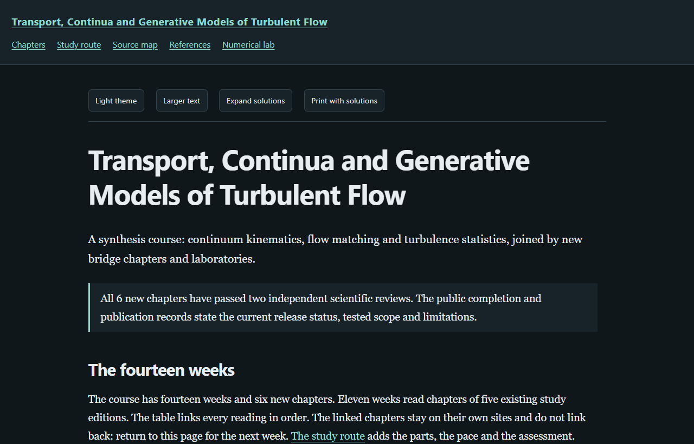

# Transport, Continua and Generative Models of Turbulent Flow

A 14-week independent graduate course that joins continuum kinematics, flow
matching and the statistical theory of turbulence. Six new chapters and two
laboratories connect chapters of five existing study editions.

[Read the online textbook](https://az9713.github.io/transport-continua-generative-turbulence-notes/)
· [Repository](https://github.com/az9713/transport-continua-generative-turbulence-notes)

- [Read the fourteen-week study route](https://az9713.github.io/transport-continua-generative-turbulence-notes/book-overview.html)
- [Start with the course map and notation](https://az9713.github.io/transport-continua-generative-turbulence-notes/chapter-01-course-map-and-notation.html)
- [Read the laboratories and their measured output](https://az9713.github.io/transport-continua-generative-turbulence-notes/numerical-lab.html)
- [Inspect source coverage](https://az9713.github.io/transport-continua-generative-turbulence-notes/source-map.html)
- [Read the workflow and evidence limits](WORKFLOW.md)

## What is new here

Eleven weeks read chapters of the source editions, which are linked and not
copied:
[Continuum Mechanics](https://az9713.github.io/nptel-continuum-mechanics-iitm-notes/),
[Fluid Mechanics](https://az9713.github.io/nptel-fluid-mechanics-kanpur-notes/),
[MIT 6.S184 Flow Matching and Diffusion](https://az9713.github.io/mit-6s184-flow-diffusion-notes/),
[Essentials of Turbulence](https://az9713.github.io/nptel-essentials-of-turbulence-notes/) and
[Turbulence Modeling](https://az9713.github.io/nptel-turbulence-modeling-notes/).
The new material is:

1. [Course map and notation](https://az9713.github.io/transport-continua-generative-turbulence-notes/chapter-01-course-map-and-notation.html)
2. [Probability density as transported mass](https://az9713.github.io/transport-continua-generative-turbulence-notes/chapter-02-density-as-mass.html)
3. [Energy spectra from discrete velocity fields](https://az9713.github.io/transport-continua-generative-turbulence-notes/chapter-03-energy-spectra-from-fields.html)
4. [Filters, heat and generation](https://az9713.github.io/transport-continua-generative-turbulence-notes/chapter-04-filters-heat-and-generation.html)
5. [Generative models of turbulence](https://az9713.github.io/transport-continua-generative-turbulence-notes/chapter-05-generative-models-of-turbulence.html)
6. [Training data and study design](https://az9713.github.io/transport-continua-generative-turbulence-notes/chapter-06-training-data-and-study-design.html)

Every chapter has complete worked solutions and an executed program. Review
status is recorded chapter by chapter in the public sidecars and in
[the editorial record](editorial-review-summary.json).

## Data and laboratories

The course generates its own data with a pseudo-spectral DNS of forced isotropic
turbulence, $256^3$, $\mathrm{Re}_\lambda=115$, 100 snapshots, run on one laptop
GPU with 4096 MiB in 2.13 hours. Its spectra and statistics are in `data/dns/`,
and every chapter program reads only those files. The 3.6 GB of snapshots are
not in the repository; [WORKFLOW.md](WORKFLOW.md) gives the commands that
regenerate them. These data have no inertial band, so they cannot test a $-5/3$
law; chapter 3 shows that measurement.

Lab 1 trains a flow-matching model in two dimensions and measures the Euler
error. Lab 2 trains a small 3D U-Net on velocity fields and judges the samples
by the spectrum, a spectral-collapse detector and gradient skewness.

Open `index.html` directly in a browser after cloning; styles, controls and
mathematical rendering are bundled for offline use. The linked chapters of the
source editions need a network connection. Chapter programs need Python
3.13 and NumPy. The laboratories add PyTorch; see `requirements.txt`.

Independent AI reviews do not constitute human expert certification. This course
is not an official publication of NPTEL or MIT.
